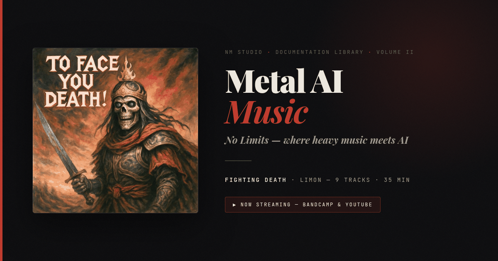

<div align="center">



# Fighting Death · Metal AI Music

**No limits.**  
An editorial publication documenting a nine-track AI-assisted metal album, composed and shipped on a mid-range Android device.

[](https://nmstudioo.github.io/FightingDeath/)


[Overview](#overview) · [Highlights](#highlights) · [Design](#design-system) · [Structure](#repository-structure)

</div>

---

## Overview

This repository documents the entire process behind *Fighting Death*—the prompts, the failures, the workflow, and the principle. It also streams the record itself through an official Bandcamp embed and a privacy-enhanced YouTube playlist, loaded on demand.

> [!NOTE]
> Words, music, and artwork © 2026 NM Studio. All rights reserved.

| Attribute | Value |
|:--|:--|
| **Album** | *Fighting Death* by Limon |
| **Tracks** | 9 |
| **Editorial chapters** | 20 |
| **Format** | Single-file static HTML |

---

## Highlights

- **The Listen plate:** A segmented switcher between Bandcamp and YouTube, with per-track playback and a now-playing strip.
- **On-demand loading:** No third-party iframe, script, or cookie runs until the visitor presses play.
- **Editorial components:** Pull quotes, callouts, principle stacks, flow diagrams, and specification tables.
- **Craft:** Tokenized design system with a film-grain texture, crimson spine motifs, and scrollspy chapter navigation.

---

## Design System — "No Limits"

Near-black backgrounds with a single crimson accent. The typography pairs high-contrast serifs for storytelling with a monospace for technical data.

| Role | Face |
|:--|:--|
| Display | **Playfair Display** |
| Body | **Source Serif 4** |
| Data | **JetBrains Mono** |

| Token | Value | Use |
|:--|:--|:--|
| `--bg` | `#0a0a0a` | Page background |
| `--crimson` | `#dc2626` | Accents, active states |
| `--mut` | `#71717a` | Muted text |

---

## Repository Structure

```text
metal-ai-music/
├── index.html          ← the publication
├── favicon.svg
├── og-image.png        ← social preview card
├── .nojekyll
└── assets/
    └── cover.jpg       ← Fighting Death album artwork
```

---

<div align="center">
<sub>Designed &amp; tuned by <b>Noushad M.</b> · © 2026</sub>
</div>
